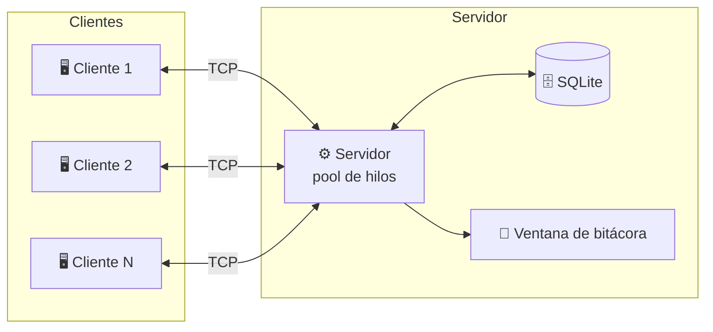

<div align="center">

# 💬 Chat Cliente-Servidor

**Sistema de mensajería instantánea con arquitectura cliente-servidor, interfaz gráfica y base de datos centralizada.**


[Progreso](#-progreso) · [Evaluación](#-evaluación) · [Arquitectura](#️-arquitectura) · [Funcionalidad](#-funcionalidad) · [Estructura](#️-estructura-del-proyecto) · [Tareas](#-tareas-por-integrante) · [Cómo contribuir](#-cómo-contribuir)

</div>

---

> [!IMPORTANT]
> **Mínimo para que califiquen el programa:** enviar un mensaje entre dos usuarios en **dos computadoras distintas**.
>
> - El equipo tiene que estar **completo** el día de la entrega.
> - Hay **una sola oportunidad** de entrega.
> - Mientras califican a un equipo, el otro no está presente.
>
> 📝 **Documentación, Parte 1:** [Google Doc del equipo](https://docs.google.com/document/d/1jrqyue062hBdZg8UxoYzg9ZF91PVpjQCReckpmSkTxU/edit?tab=t.0)

## 📊 Progreso

> Las barras se calculan solas a partir de las casillas de [Tareas](#-tareas-por-integrante). No las edites a mano.

<!-- PROGRESO:INICIO -->

| | Avance |
|---|---|
| 🏁 **Total** | `░░░░░░░░░░░░░░░░░░░░` 1% &nbsp; (1/106 tareas) |
| 💻 Código | `░░░░░░░░░░░░░░░░░░░░` 2% |
| 📄 Documentación | `░░░░░░░░░░░░░░░░░░░░` 0% |

| Área | Responsable | 💻 Código | 📄 Docs | Total |
|---|---|---|---|---|
| 🎯 Hitos | Todo el equipo | `░░░░░░░░░░` 0% | `░░░░░░░░░░` 0% | `░░░░░░░░░░` 0% |
| 00 · Documentación general | Integrante 1 | — | `░░░░░░░░░░` 0% | `░░░░░░░░░░` 0% |
| 01 · Arquitectura e integración | _sin asignar_ | `██░░░░░░░░` 17% | `░░░░░░░░░░` 0% | `█░░░░░░░░░` 11% |
| 02 · Base de datos | _sin asignar_ | `░░░░░░░░░░` 0% | `░░░░░░░░░░` 0% | `░░░░░░░░░░` 0% |
| 03 · Núcleo del servidor | _sin asignar_ | `░░░░░░░░░░` 0% | `░░░░░░░░░░` 0% | `░░░░░░░░░░` 0% |
| 04 · Ventana del servidor | _sin asignar_ | `░░░░░░░░░░` 0% | `░░░░░░░░░░` 0% | `░░░░░░░░░░` 0% |
| 05 · Registro | _sin asignar_ | `░░░░░░░░░░` 0% | `░░░░░░░░░░` 0% | `░░░░░░░░░░` 0% |
| 06 · Inicio de sesión | _sin asignar_ | `░░░░░░░░░░` 0% | `░░░░░░░░░░` 0% | `░░░░░░░░░░` 0% |
| 07 · Recuperar acceso y eliminar cuenta | _sin asignar_ | `░░░░░░░░░░` 0% | `░░░░░░░░░░` 0% | `░░░░░░░░░░` 0% |
| 08 · Ventana 1: Usuarios | _sin asignar_ | `░░░░░░░░░░` 0% | `░░░░░░░░░░` 0% | `░░░░░░░░░░` 0% |
| 09 · Amistades y notificaciones | _sin asignar_ | `░░░░░░░░░░` 0% | `░░░░░░░░░░` 0% | `░░░░░░░░░░` 0% |
| 10 · Ventana 2: Chat de amigos | _sin asignar_ | `░░░░░░░░░░` 0% | `░░░░░░░░░░` 0% | `░░░░░░░░░░` 0% |
| 11 · Ventana 3: Grupos | _sin asignar_ | `░░░░░░░░░░` 0% | `░░░░░░░░░░` 0% | `░░░░░░░░░░` 0% |
<!-- PROGRESO:FIN -->

## 🧮 Evaluación

| Rubro | Qué se entrega | Calificación |
|---|---|---|
| 📘 Documentación técnica | PDF, Parte 1: punto de vista del desarrollador | Igual para todo el equipo |
| 📗 Manual de usuario | PDF, Parte 2: punto de vista del cliente | Igual para todo el equipo |
| ⚙️ Funcionalidad del programa | Demo en vivo (la rúbrica se publica después) | Igual para todo el equipo |
| 🤝 Coevaluación | Evaluación entre integrantes | **Individual** |

<details>
<summary><b>📘 Contenido del PDF</b></summary>

**Parte 1: Punto de vista del desarrollador** ([📝 se escribe aquí](https://docs.google.com/document/d/1jrqyue062hBdZg8UxoYzg9ZF91PVpjQCReckpmSkTxU/edit?tab=t.0))
- Portada e índice
- Problemática (desarrollada, no 3 renglones)
- Casos de uso: uno por integrante
- Diagramas de secuencia: uno por integrante, cada uno sobre una acción
- Diagrama de clases con todas sus relaciones
- Diagrama de la base de datos
- Conclusión de cada integrante

**Parte 2: Punto de vista del cliente**
- Portada e índice
- Descripción del sistema como producto
- Requisitos mínimos
- Proceso de instalación (se entregan los `.jar`, no el proyecto de NetBeans)
- ¿Cómo se usa? (muy descriptivo, con capturas)

</details>

## 🏗️ Arquitectura



Ningún mensaje viaja directo de un cliente a otro: **todo pasa por el servidor**, que lo guarda, lo registra en la bitácora y lo reenvía.

## 🧩 Funcionalidad

| Módulo | Reglas clave |
|---|---|
| 🔐 **Acceso** | Registro con credenciales. Si el usuario falla 3 veces, se bloquea o se envía al registro. Puede recuperar su acceso en cualquier momento con información que dio antes (pregunta de seguridad). |
| 👥 **Ventana 1: Usuarios** | Todos los registrados, divididos en conectados y desconectados en tiempo real. Solo se puede chatear con conectados. El historial **se pierde** cuando el otro cierra sesión. Cerrar la ventana no es cerrar la sesión. |
| 🫂 **Ventana 2: Amigos** | La solicitud se envía desde la ventana 1. Se puede mandar mensaje aunque el amigo esté desconectado y le llega al conectarse. El historial **siempre se conserva** y es distinto del de la ventana 1. Al eliminar al amigo se borra la conversación. |
| 👨‍👩‍👧 **Ventana 3: Grupos** | Mínimo 3 integrantes contando al dueño; las invitaciones pendientes cuentan. La invitación llega por el chat de amigos. El dueño puede agregar, quitar, renombrar o eliminar. Si quedan menos de 3, el grupo se elimina junto con su historial. Quien se une ve todo el historial. |
| 🔔 **Notificaciones** | Solicitudes, invitaciones y mensajes nuevos. |
| 📜 **Servidor** | Ventana con el historial de todo lo que pasa. El servidor ve todo. |
| 🗑️ **Eliminar cuenta** | Borra en cascada amistades, mensajes y grupos. |

## 🗂️ Estructura del proyecto

Es un proyecto **Maven** con 3 módulos. En NetBeans, IntelliJ o VS Code: **Abrir proyecto** y elige la carpeta raíz. Ya trae Maven integrado, no instalas nada más.

```
chat-cliente-servidor/
├── pom.xml                    ← proyecto padre (junta los 3 módulos)
├── comun/                     ← código que usan el servidor Y el cliente
│   └── src/main/java/chat/comun/
│       ├── protocolo/         Paquete, Tipo (formato de los mensajes)
│       └── modelo/            Usuario, Mensaje, Grupo...
├── servidor/                  → genera Servidor.jar
│   └── src/main/
│       ├── java/chat/servidor/
│       │   ├── nucleo/        arranque, sockets, hilos, despachador
│       │   ├── bd/            SQLite y DAOs
│       │   ├── gui/           ventana del servidor (bitácora)
│       │   ├── registro/  login/  cuenta/  usuarios/
│       │   └── amistades/  chatamigos/  grupos/      ← lógica de cada función
│       └── resources/schema.sql
└── cliente/                   → genera Cliente.jar
    └── src/main/java/chat/cliente/
        ├── app/               arranque, conexión, ventana principal
        ├── registro/  login/  cuenta/  usuarios/
        └── amistades/  chatamigos/  grupos/          ← ventanas de cada función
```

> [!TIP]
> **El patrón:** cada función tiene **una carpeta con el mismo nombre** en `servidor` y en `cliente`. En `servidor` va la **lógica** y en `cliente` la **ventana**.
> Por ejemplo, el registro vive en `servidor/.../registro/` y en `cliente/.../registro/`.
> El cliente **no puede** usar código del servidor ni la BD: todo lo que necesite lo pide por el protocolo.

### 📌 Qué carpetas son de quién

> Cada carpeta tiene un `package-info.java` que dice quién es su dueño. **Solo el dueño modifica su carpeta.**

| # | Parte | Tus carpetas (y nadie más las toca) |
|---|---|---|
| 01 | Arquitectura e integración | Los 4 `pom.xml`, `comun/…/protocolo/`, `cliente/…/app/` |
| 02 | Base de datos | `servidor/…/bd/`, `servidor/src/main/resources/schema.sql`, `comun/…/modelo/` |
| 03 | Núcleo del servidor | `servidor/…/nucleo/` |
| 04 | Ventana del servidor | `servidor/…/gui/` |
| 05 | Registro | `servidor/…/registro/` + `cliente/…/registro/` |
| 06 | Inicio de sesión | `servidor/…/login/` + `cliente/…/login/` |
| 07 | Recuperar acceso y eliminar cuenta | `servidor/…/cuenta/` + `cliente/…/cuenta/` |
| 08 | Ventana 1: Usuarios | `servidor/…/usuarios/` + `cliente/…/usuarios/` |
| 09 | Amistades y notificaciones | `servidor/…/amistades/` + `cliente/…/amistades/` |
| 10 | Ventana 2: Chat de amigos | `servidor/…/chatamigos/` + `cliente/…/chatamigos/` |
| 11 | Ventana 3: Grupos | `servidor/…/grupos/` + `cliente/…/grupos/` |

> `…` = `src/main/java/chat/servidor` o `src/main/java/chat/cliente`, según el módulo.

**Lo que necesitas de otros, se lo pides a su dueño, no lo editas tú:**
- ¿Un **tipo de mensaje** nuevo (`Tipo`)? → 01
- ¿Que el servidor **mande tus paquetes** a tu servicio (`Despachador`)? → 03
- ¿Una **tabla, columna o consulta** nueva (DAO)? → 02
- ¿Que **tu ventana** se abra desde la ventana principal? → 01

### ▶️ Compilar y correr

```bash
mvn package                               # o el botón "Build" / "Clean and Build" del IDE
java -jar servidor/target/Servidor.jar    # en la computadora servidor
java -jar cliente/target/Cliente.jar      # en cada computadora cliente
```

> Los `.jar` se van a poder ejecutar cuando existan `ServidorMain` (integrante 03) y `ClienteMain` (integrante 01).

## ✅ Tareas por integrante

> Pon tu nombre después del `—` en tu encabezado y marca `[x]` cuando termines una tarea.
> Las tareas `💻` son de código y las `📄` de documentación. Detalle en [`TAREAS.md`](TAREAS.md).

<!-- TAREAS:INICIO -->

### 🎯 Hitos — Todo el equipo
- [ ] 💻 Mensaje entre dos usuarios en **dos computadoras** (mínimo para calificar)
- [ ] 💻 Prueba de todas las funciones en la red del salón
- [ ] 💻 Ensayo de la entrega con el equipo completo
- [ ] 📄 PDF de documentación técnica terminado
- [ ] 📄 PDF de manual de usuario terminado

### 00 · Documentación general — Integrante 1
- [ ] 📄 Portada (Parte 1 y Parte 2)
- [ ] 📄 Índice (Parte 1 y Parte 2)
- [ ] 📄 Problemática desarrollada
- [ ] 📄 Diagrama de clases integrado
- [ ] 📄 Descripción del sistema como producto
- [ ] 📄 Requisitos mínimos
- [ ] 📄 Proceso de instalación
- [ ] 📄 Armado final del PDF

### 01 · Arquitectura e integración —
- [x] 💻 Estructura del proyecto (`comun`, `servidor`, `cliente`)
- [ ] 💻 Protocolo: clase `Paquete` y tipos de mensaje
- [ ] 💻 Conexión del cliente (enviar y recibir en un hilo)
- [ ] 💻 Configurar IP y puerto del servidor desde la GUI
- [ ] 💻 Generar `Servidor.jar` y `Cliente.jar`
- [ ] 💻 Integrar las ramas de todos
- [ ] 📄 Caso de uso: Conectar cliente al servidor
- [ ] 📄 Diagrama de secuencia
- [ ] 📄 Conclusión

### 02 · Base de datos —
- [ ] 💻 Esquema SQLite (usuarios, amistades, mensajes, grupos, miembros, bitácora)
- [ ] 💻 DAOs para que nadie escriba SQL suelto
- [ ] 💻 Borrado en cascada (`ON DELETE CASCADE`)
- [ ] 💻 Datos de prueba
- [ ] 📄 Diagrama de la base de datos
- [ ] 📄 Caso de uso: Eliminar cuenta
- [ ] 📄 Diagrama de secuencia
- [ ] 📄 Conclusión

### 03 · Núcleo del servidor —
- [ ] 💻 `ServerSocket` con pool de hilos (para que no se sature)
- [ ] 💻 Registro de clientes conectados
- [ ] 💻 Enrutamiento de mensajes C1 → servidor → C3
- [ ] 💻 Aviso a todos cuando alguien se conecta o desconecta
- [ ] 💻 Manejo de desconexiones abruptas
- [ ] 📄 Caso de uso: Enrutar mensaje
- [ ] 📄 Diagrama de secuencia
- [ ] 📄 Conclusión

### 04 · Ventana del servidor —
- [ ] 💻 Bitácora en tiempo real
- [ ] 💻 Búsqueda y filtro en el historial
- [ ] 💻 Vista de usuarios, amistades, grupos y mensajes
- [ ] 💻 Bitácora guardada en la BD
- [ ] 📄 Caso de uso: Consultar bitácora
- [ ] 📄 Diagrama de secuencia
- [ ] 📄 Manual: ¿Cómo se usa el servidor?
- [ ] 📄 Conclusión

### 05 · Registro —
- [ ] 💻 Formulario de registro
- [ ] 💻 Validaciones (usuario único, contraseña)
- [ ] 💻 Pregunta y respuesta de seguridad
- [ ] 💻 Contraseña guardada con hash
- [ ] 📄 Caso de uso: Registrar usuario
- [ ] 📄 Diagrama de secuencia
- [ ] 📄 Manual: Registro
- [ ] 📄 Conclusión

### 06 · Inicio de sesión —
- [ ] 💻 Ventana de inicio de sesión
- [ ] 💻 Validación contra el servidor
- [ ] 💻 Bloqueo al tercer intento fallido
- [ ] 💻 Mandar al registro si el usuario no existe
- [ ] 💻 Impedir dos sesiones abiertas con el mismo usuario
- [ ] 📄 Caso de uso: Iniciar sesión
- [ ] 📄 Diagrama de secuencia
- [ ] 📄 Manual: Inicio de sesión
- [ ] 📄 Conclusión

### 07 · Recuperar acceso y eliminar cuenta —
- [ ] 💻 Ventana de recuperación con pregunta de seguridad
- [ ] 💻 Restablecer contraseña y desbloquear
- [ ] 💻 Botón "Eliminar mi cuenta" con confirmación
- [ ] 📄 Caso de uso: Recuperar acceso
- [ ] 📄 Diagrama de secuencia
- [ ] 📄 Manual: Recuperar acceso y eliminar cuenta
- [ ] 📄 Conclusión

### 08 · Ventana 1: Usuarios —
- [ ] 💻 Lista de conectados y desconectados en tiempo real
- [ ] 💻 Chat temporal, solo con conectados
- [ ] 💻 Borrar el historial cuando el otro cierra sesión
- [ ] 💻 Cerrar ventana ≠ cerrar sesión
- [ ] 💻 Botón "Agregar amigo" (se conecta con 09)
- [ ] 📄 Caso de uso: Enviar mensaje a un conectado
- [ ] 📄 Diagrama de secuencia
- [ ] 📄 Manual: Ventana de usuarios
- [ ] 📄 Conclusión

### 09 · Amistades y notificaciones —
- [ ] 💻 Enviar solicitud de amistad
- [ ] 💻 Aceptar o rechazar solicitud
- [ ] 💻 Eliminar amigo
- [ ] 💻 Ventana de notificaciones
- [ ] 📄 Caso de uso: Enviar y aceptar solicitud
- [ ] 📄 Diagrama de secuencia
- [ ] 📄 Manual: Amigos y notificaciones
- [ ] 📄 Conclusión

### 10 · Ventana 2: Chat de amigos —
- [ ] 💻 Lista de amigos con su estado
- [ ] 💻 Chat persistente, separado del de la ventana 1
- [ ] 💻 Mensajes a desconectados entregados al conectarse
- [ ] 💻 Borrar la conversación al eliminar al amigo
- [ ] 💻 Invitación a grupo dentro del chat (se conecta con 11)
- [ ] 📄 Caso de uso: Enviar mensaje a un amigo desconectado
- [ ] 📄 Diagrama de secuencia
- [ ] 📄 Manual: Chat de amigos
- [ ] 📄 Conclusión

### 11 · Ventana 3: Grupos —
- [ ] 💻 Crear grupo invitando al menos a 2 amigos
- [ ] 💻 Aceptar o rechazar invitación
- [ ] 💻 Chat de grupo persistente; quien se une ve todo el historial
- [ ] 💻 Dueño: agregar, quitar, renombrar, eliminar
- [ ] 💻 Salir del grupo
- [ ] 💻 Eliminar el grupo si quedan menos de 3
- [ ] 📄 Caso de uso: Crear grupo e invitar amigos
- [ ] 📄 Diagrama de secuencia
- [ ] 📄 Manual: Grupos
- [ ] 📄 Conclusión

<!-- TAREAS:FIN -->

## 🤝 Cómo contribuir

> [!WARNING]
> **Nunca subas cambios directo a `main`.** Todo entra por Pull Request (PR). `main` siempre tiene que compilar y correr, porque es lo que se entrega.

### 🧰 Paso 0: Preparación (solo la primera vez)

1. **Pide acceso al repo.** Pasa tu usuario de GitHub al dueño del repo para que te agregue como colaborador. Te llega una invitación por correo y tienes que **aceptarla**.
2. **Instala:**
   - [Git](https://git-scm.com/downloads)
   - [JDK 17](https://adoptium.net/) o una versión más nueva
   - El IDE que quieras (NetBeans, IntelliJ o VS Code)
3. **Configura tu nombre** para que tus commits salgan a tu nombre. Esto cuenta en la coevaluación:
   ```bash
   git config --global user.name "Tu Nombre"
   git config --global user.email "el-correo-de-tu-github@ejemplo.com"
   ```
4. **Clona el repo:**
   ```bash
   git clone https://github.com/FieldRayo/chat-cliente-servidor.git
   cd chat-cliente-servidor
   ```
5. **Pon tu nombre** en tu encabezado de [Tareas](#-tareas-por-integrante) (por ejemplo `### 05 · Registro — Juan Pérez`). Súbelo en tu primer PR.

### 🔁 El flujo: cada vez que trabajes en tu parte

**1. Trae lo más nuevo de `main`** antes de empezar:
```bash
git checkout main
git pull
```

**2. Crea tu rama**, o vuelve a ella si ya la tienes. El nombre de la rama es `<tu número>-<tu tema>`:
```bash
git checkout -b 05-registro      # la primera vez
git checkout 05-registro         # las siguientes veces
git merge main                   # trae a tu rama lo que otros ya integraron
```

| Rama | Rama | Rama |
|---|---|---|
| `01-arquitectura` | `05-registro` | `09-amistades` |
| `02-base-datos` | `06-login` | `10-chat-amigos` |
| `03-servidor` | `07-recuperar-cuenta` | `11-grupos` |
| `04-ventana-servidor` | `08-ventana-usuarios` | |

**3. Programa tu parte.** Reglas:
- Toca solo **tus carpetas** (ver [Qué carpetas son de quién](#-qué-carpetas-son-de-quién)). Si necesitas algo de otra carpeta, pídeselo a su dueño.
- Para enviar o recibir datos usa el **protocolo** (`Paquete`) del integrante 1. No inventes tu propio formato.
- Para la BD usa los **DAOs** del integrante 2. No escribas SQL en tu ventana.
- Antes de subir, comprueba que **compila y corre**.

**4. Guarda tu avance (commit).** Haz commits pequeños y seguido, con un mensaje que diga qué hiciste:
```bash
git add .
git commit -m "Registro: validar que el usuario no exista"
```

**5. Súbelo a GitHub (push):**
```bash
git push -u origin 05-registro   # la primera vez
git push                         # las siguientes veces
```

**6. Abre el Pull Request.** Cuando una tarea esté lista:
1. Entra al repo en GitHub. Va a salir un botón amarillo **"Compare & pull request"**. Dale clic.
2. Revisa que diga **base: `main`** ← **compare: `tu-rama`**.
3. **Título:** `[05] Registro: formulario y validaciones`
4. **Descripción:** qué hiciste, cómo probarlo y capturas de pantalla si tiene ventana.
5. **En el mismo PR**, marca con `[x]` en el README las tareas que terminaste.
6. Pon como *Reviewer* al **integrante 1**.

**7. Revisión y merge.** El integrante 1 lo prueba:
- ✅ Si funciona, hace el merge. Las barras de progreso se actualizan solas.
- 🔧 Si pide cambios, corrígelos en **la misma rama**, haz commit y push. El PR se actualiza solo, no abras otro.

**8. Repite** desde el paso 1 con tu siguiente tarea.

### 🆘 Problemas comunes

| Situación | Qué hacer |
|---|---|
| `git push` te pide usuario y contraseña | GitHub ya no acepta tu contraseña. Usa un [token](https://github.com/settings/tokens) como contraseña o inicia sesión con [GitHub CLI](https://cli.github.com/) (`gh auth login`). |
| `CONFLICT` al hacer `git merge main` | Abre los archivos marcados. Busca los `<<<<<<<` y `>>>>>>>`, deja la versión correcta y borra las marcas. Luego `git add .` y `git commit`. Si no sabes cuál dejar, pregunta al dueño de ese código. |
| Hiciste cambios en `main` por error | Antes de hacer commit, corre `git checkout -b <tu-rama>`. Tus cambios se van a la rama nueva. |
| Tu parte depende de otra que no está lista | Usa datos de prueba en tu ventana y avisa en el grupo. No te quedes esperando. |
| No sabes algo | Pregunta en el grupo. Es mejor preguntar que romper `main`. |

### 📄 Tu parte de la documentación

No va en el repo. La **Parte 1 (documentación técnica)** se escribe en este **[Google Doc](https://docs.google.com/document/d/1jrqyue062hBdZg8UxoYzg9ZF91PVpjQCReckpmSkTxU/edit?tab=t.0)**. Escribe en **tu sección**, que tiene tu número:
- Caso de uso y diagrama de secuencia de tu acción
- Las clases que hiciste, para que el integrante 1 arme el diagrama de clases
- Si tienes ventana: la sección "¿Cómo se usa?", con capturas
- Tu conclusión

Cuando la termines, marca tus casillas 📄 en el README con un PR, igual que el código.
