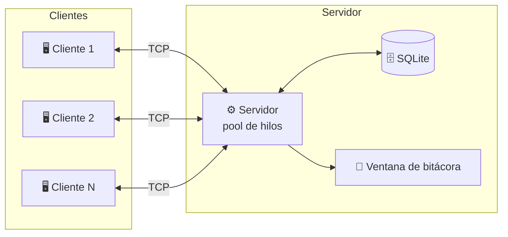

<div align="center">

# 💬 Chat Cliente-Servidor

**Sistema de mensajería instantánea con arquitectura cliente-servidor, interfaz gráfica y base de datos centralizada.**


[Progreso](#-progreso) · [Evaluación](#-evaluación) · [Arquitectura](#️-arquitectura) · [Funcionalidad](#-funcionalidad) · [Estructura](#️-estructura-del-proyecto) · [Tareas](#-tareas-por-integrante) · [Cómo contribuir](#-cómo-contribuir)

</div>

---

> [!IMPORTANT]
> **Mínimo para que califiquen el programa:** enviar un mensaje entre dos usuarios en **dos computadoras distintas**.
>
> - El equipo tiene que estar **completo** el día de la entrega.
> - Hay **una sola oportunidad** de entrega.
> - Mientras califican a un equipo, el otro no está presente.
>
> 📝 **Documentación:** [Parte 1, técnica](https://docs.google.com/document/d/1jrqyue062hBdZg8UxoYzg9ZF91PVpjQCReckpmSkTxU/edit?tab=t.0) · [Parte 2, manual de usuario](https://docs.google.com/document/d/1z9OzryCyVB0iSMNRN0eGJvV00Gp6TCn5K5AyRN0jGhs/edit?tab=t.0)

## 📊 Progreso

> Las barras se calculan solas a partir de las casillas de [Tareas](#-tareas-por-integrante). No las edites a mano.

<!-- PROGRESO:INICIO -->

| | Avance |
|---|---|
| 🏁 **Total** | `░░░░░░░░░░░░░░░░░░░░` 1% &nbsp; (1/106 tareas) |
| 💻 Código | `░░░░░░░░░░░░░░░░░░░░` 2% |
| 📄 Documentación | `░░░░░░░░░░░░░░░░░░░░` 0% |

| Área | Responsable | 💻 Código | 📄 Docs | Total |
|---|---|---|---|---|
| 🎯 Hitos | Todo el equipo | `░░░░░░░░░░` 0% | `░░░░░░░░░░` 0% | `░░░░░░░░░░` 0% |
| 00 · Documentación general | Integrante 1 | — | `░░░░░░░░░░` 0% | `░░░░░░░░░░` 0% |
| 01 · Arquitectura e integración | _sin asignar_ | `██░░░░░░░░` 17% | `░░░░░░░░░░` 0% | `█░░░░░░░░░` 11% |
| 02 · Base de datos | _sin asignar_ | `░░░░░░░░░░` 0% | `░░░░░░░░░░` 0% | `░░░░░░░░░░` 0% |
| 03 · Núcleo del servidor | _sin asignar_ | `░░░░░░░░░░` 0% | `░░░░░░░░░░` 0% | `░░░░░░░░░░` 0% |
| 04 · Ventana del servidor | _sin asignar_ | `░░░░░░░░░░` 0% | `░░░░░░░░░░` 0% | `░░░░░░░░░░` 0% |
| 05 · Registro | _sin asignar_ | `░░░░░░░░░░` 0% | `░░░░░░░░░░` 0% | `░░░░░░░░░░` 0% |
| 06 · Inicio de sesión | _sin asignar_ | `░░░░░░░░░░` 0% | `░░░░░░░░░░` 0% | `░░░░░░░░░░` 0% |
| 07 · Recuperar acceso y eliminar cuenta | _sin asignar_ | `░░░░░░░░░░` 0% | `░░░░░░░░░░` 0% | `░░░░░░░░░░` 0% |
| 08 · Ventana 1: Usuarios | _sin asignar_ | `░░░░░░░░░░` 0% | `░░░░░░░░░░` 0% | `░░░░░░░░░░` 0% |
| 09 · Amistades y notificaciones | _sin asignar_ | `░░░░░░░░░░` 0% | `░░░░░░░░░░` 0% | `░░░░░░░░░░` 0% |
| 10 · Ventana 2: Chat de amigos | _sin asignar_ | `░░░░░░░░░░` 0% | `░░░░░░░░░░` 0% | `░░░░░░░░░░` 0% |
| 11 · Ventana 3: Grupos | _sin asignar_ | `░░░░░░░░░░` 0% | `░░░░░░░░░░` 0% | `░░░░░░░░░░` 0% |
<!-- PROGRESO:FIN -->

## 🧮 Evaluación

| Rubro | Qué se entrega | Calificación |
|---|---|---|
| 📘 Documentación técnica | PDF, Parte 1: punto de vista del desarrollador | Igual para todo el equipo |
| 📗 Manual de usuario | PDF, Parte 2: punto de vista del cliente | Igual para todo el equipo |
| ⚙️ Funcionalidad del programa | Demo en vivo (la rúbrica se publica después) | Igual para todo el equipo |
| 🤝 Coevaluación | Evaluación entre integrantes | **Individual** |

<details>
<summary><b>📘 Contenido del PDF</b></summary>

**Parte 1: Punto de vista del desarrollador** ([📝 se escribe aquí](https://docs.google.com/document/d/1jrqyue062hBdZg8UxoYzg9ZF91PVpjQCReckpmSkTxU/edit?tab=t.0))
- Portada e índice
- Problemática (desarrollada, no 3 renglones)
- Casos de uso: uno por integrante
- Diagramas de secuencia: uno por integrante, cada uno sobre una acción
- Diagrama de clases con todas sus relaciones
- Diagrama de la base de datos
- Conclusión de cada integrante

**Parte 2: Punto de vista del cliente** ([📝 se escribe aquí](https://docs.google.com/document/d/1z9OzryCyVB0iSMNRN0eGJvV00Gp6TCn5K5AyRN0jGhs/edit?tab=t.0))
- Portada e índice
- Descripción del sistema como producto
- Requisitos mínimos
- Proceso de instalación (se entregan los `.jar`, no el proyecto de NetBeans)
- ¿Cómo se usa? (muy descriptivo, con capturas)

</details>

## 🏗️ Arquitectura



Ningún mensaje viaja directo de un cliente a otro: **todo pasa por el servidor**, que lo guarda, lo registra en la bitácora y lo reenvía.

## 🧩 Funcionalidad

| Módulo | Reglas clave |
|---|---|
| 🔐 **Acceso** | Registro con credenciales. Si el usuario falla 3 veces, se bloquea o se envía al registro. Puede recuperar su acceso en cualquier momento con información que dio antes (pregunta de seguridad). |
| 👥 **Ventana 1: Usuarios** | Todos los registrados, divididos en conectados y desconectados en tiempo real. Solo se puede chatear con conectados. El historial **se pierde** cuando el otro cierra sesión. Cerrar la ventana no es cerrar la sesión. |
| 🫂 **Ventana 2: Amigos** | La solicitud se envía desde la ventana 1. Se puede mandar mensaje aunque el amigo esté desconectado y le llega al conectarse. El historial **siempre se conserva** y es distinto del de la ventana 1. Al eliminar al amigo se borra la conversación. |
| 👨‍👩‍👧 **Ventana 3: Grupos** | Mínimo 3 integrantes contando al dueño; las invitaciones pendientes cuentan. La invitación llega por el chat de amigos. El dueño puede agregar, quitar, renombrar o eliminar. Si quedan menos de 3, el grupo se elimina junto con su historial. Quien se une ve todo el historial. |
| 🔔 **Notificaciones** | Solicitudes, invitaciones y mensajes nuevos. |
| 📜 **Servidor** | Ventana con el historial de todo lo que pasa. El servidor ve todo. |
| 🗑️ **Eliminar cuenta** | Borra en cascada amistades, mensajes y grupos. |

## 🗂️ Estructura del proyecto

Es un proyecto **Maven** con 3 módulos. En NetBeans, IntelliJ o VS Code: **Abrir proyecto** y elige la carpeta raíz. Ya trae Maven integrado, no instalas nada más.

```
chat-cliente-servidor/
├── pom.xml                    ← proyecto padre (junta los 3 módulos)
├── comun/                     ← código que usan el servidor Y el cliente
│   └── src/main/java/chat/comun/
│       ├── protocolo/         Paquete, Tipo (formato de los mensajes)
│       └── modelo/            Usuario, Mensaje, Grupo...
├── servidor/                  → genera Servidor.jar
│   └── src/main/
│       ├── java/chat/servidor/
│       │   ├── nucleo/        arranque, sockets, hilos, despachador
│       │   ├── bd/            SQLite y DAOs
│       │   ├── gui/           ventana del servidor (bitácora)
│       │   ├── registro/  login/  cuenta/  usuarios/
│       │   └── amistades/  chatamigos/  grupos/      ← lógica de cada función
│       └── resources/schema.sql
└── cliente/                   → genera Cliente.jar
    └── src/main/java/chat/cliente/
        ├── app/               arranque, conexión, ventana principal
        ├── registro/  login/  cuenta/  usuarios/
        └── amistades/  chatamigos/  grupos/          ← ventanas de cada función
```

> [!TIP]
> **El patrón:** cada función tiene **una carpeta con el mismo nombre** en `servidor` y en `cliente`. En `servidor` va la **lógica** y en `cliente` la **ventana**.
> Por ejemplo, el registro vive en `servidor/.../registro/` y en `cliente/.../registro/`.
> El cliente **no puede** usar código del servidor ni la BD: todo lo que necesite lo pide por el protocolo.

### 📌 Qué carpetas son de quién

> Cada carpeta tiene un `package-info.java` que dice quién es su dueño. **Solo el dueño modifica su carpeta.**

| # | Parte | Tus carpetas (y nadie más las toca) |
|---|---|---|
| 01 | Arquitectura e integración | Los 4 `pom.xml`, `comun/…/protocolo/`, `cliente/…/app/` |
| 02 | Base de datos | `servidor/…/bd/`, `servidor/src/main/resources/schema.sql`, `comun/…/modelo/` |
| 03 | Núcleo del servidor | `servidor/…/nucleo/` |
| 04 | Ventana del servidor | `servidor/…/gui/` |
| 05 | Registro | `servidor/…/registro/` + `cliente/…/registro/` |
| 06 | Inicio de sesión | `servidor/…/login/` + `cliente/…/login/` |
| 07 | Recuperar acceso y eliminar cuenta | `servidor/…/cuenta/` + `cliente/…/cuenta/` |
| 08 | Ventana 1: Usuarios | `servidor/…/usuarios/` + `cliente/…/usuarios/` |
| 09 | Amistades y notificaciones | `servidor/…/amistades/` + `cliente/…/amistades/` |
| 10 | Ventana 2: Chat de amigos | `servidor/…/chatamigos/` + `cliente/…/chatamigos/` |
| 11 | Ventana 3: Grupos | `servidor/…/grupos/` + `cliente/…/grupos/` |

> `…` = `src/main/java/chat/servidor` o `src/main/java/chat/cliente`, según el módulo.

**Lo que necesitas de otros, se lo pides a su dueño, no lo editas tú:**
- ¿Un **tipo de mensaje** nuevo (`Tipo`)? → 01
- ¿Que el servidor **mande tus paquetes** a tu servicio (`Despachador`)? → 03
- ¿Una **tabla, columna o consulta** nueva (DAO)? → 02
- ¿Que **tu ventana** se abra desde la ventana principal? → 01

### ▶️ Compilar y correr

```bash
mvn package                               # o el botón "Build" / "Clean and Build" del IDE
java -jar servidor/target/Servidor.jar    # en la computadora servidor
java -jar cliente/target/Cliente.jar      # en cada computadora cliente
```

> Los `.jar` se van a poder ejecutar cuando existan `ServidorMain` (integrante 03) y `ClienteMain` (integrante 01).

## ✅ Tareas por integrante

> **Busca tu número**, abre tu **📖 Guía detallada** y ahí está todo lo que te toca.
> Pon tu nombre después del `—` en tu encabezado y marca `[x]` cuando termines una tarea.
> Las tareas `💻` son de código y las `📄` de documentación. Detalle en [`TAREAS.md`](TAREAS.md).

### 📝 Cómo hacer tu documentación (aplica a todos)

> Cada área tiene abajo su **📖 Guía detallada** con su caso de uso, su diagrama y su sección del manual. Este es el formato común.

| Entregable | Dónde | Formato |
|---|---|---|
| **Caso de uso** | Parte 1 | Nombre · Actor · Precondición · Flujo principal (pasos numerados) · Flujos alternos · Postcondición, y el **diagrama de caso de uso** |
| **Diagrama de secuencia** | Parte 1 | **Una sola acción**. Participantes de izquierda a derecha: Usuario → Ventana → `Conexion` → `ManejadorCliente` → `Despachador` → Servicio → DAO → BD, con las respuestas en línea punteada |
| **Tus clases** | Al integrante 00/01 | Nombre, atributos y métodos de cada clase tuya, y con qué clases se relaciona |
| **¿Cómo se usa?** | Parte 2 | Paso a paso **con capturas**, escrito para alguien que no programa. Incluye los mensajes de error que puede ver |
| **Conclusión** | Parte 1 | Personal: qué hiciste, qué aprendiste y qué fue lo más difícil |

> Herramientas sugeridas para los diagramas: [draw.io](https://app.diagrams.net/), StarUML o PlantUML. Usen **la misma** herramienta todos, para que se vean iguales.

<!-- TAREAS:INICIO -->

### 🎯 Hitos — Todo el equipo

> 🎯 **Objetivo:** que el día de la entrega todo funcione a la primera, porque **no hay segunda oportunidad**.

- [ ] 💻 Mensaje entre dos usuarios en **dos computadoras** (mínimo para calificar)
- [ ] 💻 Prueba de todas las funciones en la red del salón
- [ ] 💻 Ensayo de la entrega con el equipo completo
- [ ] 📄 PDF de documentación técnica terminado
- [ ] 📄 PDF de manual de usuario terminado

<details>
<summary><b>📖 Guía detallada: qué tienes que hacer</b></summary>

**🖧 Cómo probar en dos computadoras**
1. Conecta las dos computadoras a **la misma red** (el mismo WiFi o switch).
2. En la computadora servidor abre una terminal y busca su IP con `ipconfig` (Windows) o `ip a` (Linux/Mac). Será algo como `192.168.1.20`.
3. Abre el puerto del servidor en el **firewall de Windows**. Si no lo haces, los clientes no se van a poder conectar.
4. Desde la computadora cliente, comprueba la conexión con `ping 192.168.1.20`.
5. Corre `Servidor.jar` en una computadora y `Cliente.jar` en la otra. En el cliente escribe la IP del servidor.
6. Inicia sesión con dos usuarios distintos y envía un mensaje. **Ese es el mínimo para que califiquen.**

**🎬 Ensayo de la entrega**
- Hagan al menos **un ensayo completo con los 11 presentes**, en la red del salón si se puede.
- Preparen un guion con el orden de la demo:
  1. Registro
  2. Login fallido 3 veces
  3. Recuperar acceso
  4. Chat temporal
  5. Solicitud de amistad
  6. Mensaje a un amigo desconectado
  7. Crear grupo
  8. Salir del grupo hasta que se elimine
  9. Eliminar cuenta
  10. Bitácora del servidor
- Cada quien presenta su parte.
- Lleven los `.jar` y Java en una **USB**, por si falla el internet.

**📄 PDFs**
- Junten las secciones de todos y revisen la ortografía, el formato y el índice.
- Exporten a PDF **un día antes** de la entrega, no el mismo día.

</details>

### 00 · Documentación general — Integrante 1

> 🎯 **Objetivo:** armar las partes del documento que no son de un solo integrante y unir todo en los dos PDF.
>
> 🔗 **Te necesitan:** nadie puede entregar sin tu armado final · **Dependes de:** que todos terminen su sección.

- [ ] 📄 Portada (Parte 1 y Parte 2)
- [ ] 📄 Índice (Parte 1 y Parte 2)
- [ ] 📄 Problemática desarrollada
- [ ] 📄 Diagrama de clases integrado
- [ ] 📄 Descripción del sistema como producto
- [ ] 📄 Requisitos mínimos
- [ ] 📄 Proceso de instalación
- [ ] 📄 Armado final del PDF

<details>
<summary><b>📖 Guía detallada: qué tienes que hacer</b></summary>

**📘 Parte 1: Documentación técnica**
- **Portada:** escuela, materia, profesor, nombre del proyecto, los 11 nombres con su matrícula, grupo y fecha.
- **Índice:** usa el índice automático de Google Docs (Insertar → Índice), así se actualiza solo.
- **Problemática:** mínimo 1 a 2 páginas, **no 3 renglones**. Estructura sugerida:
  1. **Contexto:** por qué una organización necesita mensajería interna en su red.
  2. **Problema:** comunicación sin control central, sin historial, sin seguridad de acceso y con riesgo de saturación.
  3. **Requisitos:** todo pasa por el servidor, acceso con credenciales, chats temporales y permanentes, grupos.
  4. **Objetivo general y objetivos específicos.**
  5. **Alcance y limitaciones:** solo red local, un servidor y varios clientes.
- **Diagrama de clases:** pide a cada integrante sus clases con atributos y métodos. Únelas en **un solo diagrama** con sus relaciones (asociación, composición, herencia, dependencia) y su multiplicidad. Herramientas: draw.io, StarUML o PlantUML.

**📗 Parte 2: Manual de usuario**
- **Descripción del sistema:** explícalo **como producto**, no como código. Qué es, para quién es, qué puede hacer el usuario y sus ventajas.
- **Requisitos mínimos:**
  - Java 17 o más nuevo
  - Windows, Linux o macOS
  - Red local
  - Unos 2 GB de RAM
  - El puerto del servidor abierto en el firewall
- **Proceso de instalación** (en equipo con 02):
  1. Instalar Java.
  2. Copiar `Servidor.jar` o `Cliente.jar`.
  3. Abrirlo con doble clic o con `java -jar`.
  4. Abrir el puerto en el firewall de la computadora servidor.
  - Cada paso lleva capturas. **No se entrega NetBeans ni el código.**

**✅ Armado final:** la misma fuente, los mismos estilos de título y las figuras numeradas ("Figura 3. Diagrama de clases").

</details>

### 01 · Arquitectura e integración —

> 🎯 **Objetivo:** definir **cómo hablan** el cliente y el servidor, y que todas las partes se unan en dos `.jar` que funcionen.
>
> 📁 **Tus carpetas:** los 4 `pom.xml`, `comun/…/protocolo/`, `cliente/…/app/`
>
> 🔗 **Te necesitan:** **todos**, así que tu protocolo va primero, en la semana 1 · **Dependes de:** nadie.

- [x] 💻 Estructura del proyecto (`comun`, `servidor`, `cliente`)
- [ ] 💻 Protocolo: clase `Paquete` y tipos de mensaje
- [ ] 💻 Conexión del cliente (enviar y recibir en un hilo)
- [ ] 💻 Configurar IP y puerto del servidor desde la GUI
- [ ] 💻 Generar `Servidor.jar` y `Cliente.jar`
- [ ] 💻 Integrar las ramas de todos
- [ ] 📄 Caso de uso: Conectar cliente al servidor
- [ ] 📄 Diagrama de secuencia
- [ ] 📄 Conclusión

<details>
<summary><b>📖 Guía detallada: qué tienes que hacer</b></summary>

**💻 Código**
1. **`Paquete`** (`comun/…/protocolo/`): es lo único que viaja por la red. Debe ser `Serializable` y tener `tipo`, `de`, `para` y `datos`.
2. **`Tipo`** (enum): define **desde el día 1 todos los tipos**, para que nadie tenga que editarlo después:
   - **Acceso:** `REGISTRO`, `LOGIN`, `LOGOUT`, `RECUPERAR_PREGUNTA`, `RECUPERAR`, `ELIMINAR_CUENTA`
   - **Usuarios:** `LISTA_USUARIOS`, `USUARIO_CONECTADO`, `USUARIO_DESCONECTADO`, `MSG_TEMPORAL`
   - **Amigos:** `SOLICITUD_AMISTAD`, `RESPUESTA_AMISTAD`, `ELIMINAR_AMIGO`, `LISTA_AMIGOS`, `MSG_AMIGO`, `HISTORIAL_AMIGO`
   - **Grupos:** `GRUPO_CREAR`, `GRUPO_INVITAR`, `GRUPO_RESPUESTA`, `GRUPO_MSG`, `GRUPO_HISTORIAL`, `GRUPO_SALIR`, `GRUPO_QUITAR`, `GRUPO_RENOMBRAR`, `GRUPO_ELIMINAR`
   - **Generales:** `NOTIFICACION`, `OK`, `ERROR`
3. **`Conexion`** (`cliente/…/app/`): abre el `Socket` y usa `ObjectOutputStream`/`ObjectInputStream`.
   - Tiene un **hilo lector** que recibe los paquetes.
   - Ofrece `enviar(Paquete)` y `alRecibir(Tipo, Consumer<Paquete>)`. Así cada ventana se suscribe a sus tipos **sin tocar tu carpeta**.
   - Entrega los paquetes a Swing con `SwingUtilities.invokeLater`.
4. **`ClienteMain`**:
   1. Pide la IP y el puerto del servidor. Recuerda los últimos con `java.util.prefs.Preferences`.
   2. Se conecta.
   3. Abre el login (06).
5. **`VentanaPrincipal`**: se abre después del login. Tiene botones para abrir la Ventana 1 (08), la 2 (10), la 3 (11), Notificaciones (09) y Eliminar cuenta (07), además de **Cerrar sesión**.
6. **Integración:** revisa y haz el merge de los PR de todos. Genera los jars con `mvn package` y prueba en dos computadoras.

**⚠️ Reglas que debe cumplir tu parte**
- Todo pasa por el servidor: el cliente **nunca** se conecta con otro cliente.
- Cerrar una ventana **no** es cerrar la sesión. Solo el botón *Cerrar sesión* hace `LOGOUT`.

**🧪 Está listo cuando…**
- Dos clientes en computadoras distintas se conectan al servidor y se mandan un `Paquete`.
- `mvn package` genera `Servidor.jar` y `Cliente.jar`, y abren con doble clic.

**📄 Documentación**
- **Caso de uso "Conectar cliente al servidor"**
  - **Actor:** usuario.
  - **Precondición:** el servidor está encendido.
  - **Flujo principal:** el usuario abre el cliente, escribe la IP, se conecta y aparece el login.
  - **Flujos alternos:** IP incorrecta o servidor apagado: muestra un error y deja reintentar.
- **Diagrama de secuencia:** Usuario → `ClienteMain` → `Conexion` → `ServerSocket` (03) → `ManejadorCliente` (03) → respuesta → `VentanaLogin` (06).

</details>

### 02 · Base de datos —

> 🎯 **Objetivo:** guardar todo lo que debe sobrevivir y que **nadie más escriba SQL**.
>
> 📁 **Tus carpetas:** `servidor/…/bd/`, `servidor/src/main/resources/schema.sql`, `comun/…/modelo/`
>
> 🔗 **Te necesitan:** 03 a 11, todos usan tus DAOs, así que vas en la semana 1 · **Dependes de:** nadie.

- [ ] 💻 Esquema SQLite (usuarios, amistades, mensajes, grupos, miembros, bitácora)
- [ ] 💻 DAOs para que nadie escriba SQL suelto
- [ ] 💻 Borrado en cascada (`ON DELETE CASCADE`)
- [ ] 💻 Datos de prueba
- [ ] 📄 Diagrama de la base de datos
- [ ] 📄 Caso de uso: Eliminar cuenta
- [ ] 📄 Diagrama de secuencia
- [ ] 📄 Conclusión

<details>
<summary><b>📖 Guía detallada: qué tienes que hacer</b></summary>

**💻 Código**
1. **`schema.sql`**, con las tablas sugeridas:

   | Tabla | Columnas clave |
   |---|---|
   | `usuarios` | `id`, `usuario` UNIQUE, `hash`, `sal`, `pregunta`, `respuesta_hash`, `intentos`, `bloqueado` |
   | `amistades` | `solicitante` FK, `receptor` FK, `estado` (PENDIENTE/ACEPTADA) |
   | `mensajes_amigos` | `de` FK, `para` FK, `texto`, `fecha`, `entregado` |
   | `grupos` | `id`, `nombre`, `dueno` FK |
   | `grupo_miembros` | `grupo` FK, `usuario` FK, `estado` (PENDIENTE/ACTIVO) |
   | `mensajes_grupo` | `grupo` FK, `de` FK, `texto`, `fecha` |
   | `bitacora` | `fecha`, `evento` |

2. Todas las FK llevan **`ON DELETE CASCADE`**. Así, al borrar un usuario se borran solas sus amistades, sus mensajes y sus membresías.
   - SQLite necesita `PRAGMA foreign_keys = ON;` **en cada conexión**. Si no, la cascada no funciona.
3. **`BaseDatos`**: abre la conexión a `chat.db` y crea las tablas desde `schema.sql` si no existen.
4. **DAOs** (`UsuarioDAO`, `AmistadDAO`, `MensajeAmigoDAO`, `GrupoDAO`, `BitacoraDAO`):
   - Usa siempre **`PreparedStatement`**, nunca concatenes texto, para evitar la inyección SQL.
   - Los métodos tienen nombres claros: `existe(usuario)`, `pendientesDe(usuario)`, `historial(a, b)`, `contarMiembros(grupo)`...
5. **Modelos** (`comun/…/modelo/`): `Usuario`, `Mensaje`, `Grupo`, `Solicitud`. Son `Serializable` y **nunca** llevan el hash de la contraseña.
6. **Datos de prueba:** unos 5 usuarios y algunas amistades, para que los demás prueben sin registrarse cada vez.

**⚠️ Reglas que debe cumplir tu parte**
- Si el dueño de un grupo elimina su cuenta, su grupo se elimina.
- Si se va un miembro, el servicio de 11 revisa si quedan menos de 3. Ofrécele `contarMiembros(grupo)`.
- El chat temporal (ventana 1) **no se guarda** como historial. Solo queda el registro en la bitácora.

**🧪 Está listo cuando…**
- Borras un usuario y desaparecen sus amistades, sus mensajes y sus grupos.
- Los demás ya usan tus DAOs sin escribir SQL.

**📄 Documentación**
- **Diagrama de la BD (entidad-relación):** tablas, llaves primarias, llaves foráneas y la cardinalidad de cada relación.
- **Caso de uso "Eliminar cuenta"**
  - **Actor:** usuario.
  - **Flujo principal:** confirma con su contraseña y el sistema borra en cascada amistades, chats y grupos.
  - **Flujo alterno:** contraseña incorrecta.
- **Diagrama de secuencia:** `VentanaCuenta` (07) → `Conexion` → `Despachador` → `CuentaServicio` → `UsuarioDAO.eliminar` → SQLite (cascada).
- **Parte 2:** apoya a 00 con el proceso de instalación. `chat.db` se crea sola junto a `Servidor.jar`.

</details>

### 03 · Núcleo del servidor —

> 🎯 **Objetivo:** el corazón del sistema. Recibe todos los paquetes y los entrega a quien corresponde **sin saturarse**.
>
> 📁 **Tus carpetas:** `servidor/…/nucleo/`
>
> 🔗 **Te necesitan:** 04 a 11 · **Dependes de:** 01 (protocolo) y 02 (BD).

- [ ] 💻 `ServerSocket` con pool de hilos (para que no se sature)
- [ ] 💻 Registro de clientes conectados
- [ ] 💻 Enrutamiento de mensajes C1 → servidor → C3
- [ ] 💻 Aviso a todos cuando alguien se conecta o desconecta
- [ ] 💻 Manejo de desconexiones abruptas
- [ ] 📄 Caso de uso: Enrutar mensaje
- [ ] 📄 Diagrama de secuencia
- [ ] 📄 Conclusión

<details>
<summary><b>📖 Guía detallada: qué tienes que hacer</b></summary>

**💻 Código**
1. **`ServidorMain`**:
   1. Inicializa la BD (02).
   2. Abre la ventana del servidor (04).
   3. Abre un `ServerSocket` en el puerto `5000`.
2. **Pool de hilos:** usa `Executors.newFixedThreadPool(N)` para no crear hilos sin límite. **Esto evita que el servidor se sature.** Cada cliente aceptado se atiende con un `ManejadorCliente`.
3. **`ManejadorCliente`**:
   - Lee paquetes en un ciclo y se los pasa al `Despachador`.
   - Si el cliente se desconecta de golpe (excepción o fin del flujo), lo saca de las sesiones y avisa a todos.
4. **`Sesiones`** (`ConcurrentHashMap` de usuario → manejador):
   - `iniciar(usuario, manejador)`
   - `cerrar(usuario)`
   - `estaConectado(usuario)`
   - `enviarA(usuario, paquete)`: es el **enrutamiento C1 → servidor → C3**.
   - `difundir(paquete)`
5. **`Despachador`**:
   - Según el `Tipo` del paquete, llama al servicio de cada módulo (`RegistroServicio`, `LoginServicio`...).
   - Registra **cada paquete en la bitácora** (04). Así el servidor "ve todo".
   - Los demás te piden que conectes su servicio. Es una línea por servicio.
6. Cuando alguien entra o sale, difunde `USUARIO_CONECTADO` o `USUARIO_DESCONECTADO`. Con eso 08 y 10 actualizan sus listas en tiempo real.

**⚠️ Reglas que debe cumplir tu parte**
- Escribe en el `ObjectOutputStream` de cada cliente con `synchronized`. Si dos hilos escriben a la vez, se corrompe el flujo.
- Una desconexión abrupta cuenta igual que cerrar sesión: los demás deben verlo como desconectado.

**🧪 Está listo cuando…**
- Con 3 clientes conectados, C1 le manda a C3 y C2 no recibe nada.
- Cierras un cliente a la fuerza y los otros lo ven desconectado.

**📄 Documentación**
- **Caso de uso "Enrutar mensaje de C1 a C3"**
  - **Actor:** usuario C1.
  - **Precondición:** C1 y C3 tienen sesión iniciada.
  - **Flujo principal:** C1 envía, el servidor recibe, lo registra y se lo entrega a C3.
  - **Flujo alterno:** C3 se desconectó y el servidor responde con `ERROR`.
- **Diagrama de secuencia:** C1 `Conexion` → `ManejadorCliente(C1)` → `Despachador` → `Bitacora` → `Sesiones.enviarA` → `ManejadorCliente(C3)` → C3 `Conexion`.
- **Problemática:** dale a 00 el texto sobre la saturación del servidor y el control centralizado.

</details>

### 04 · Ventana del servidor —

> 🎯 **Objetivo:** que el servidor **vea todo** lo que pasa en el sistema, en tiempo real y con historial.
>
> 📁 **Tus carpetas:** `servidor/…/gui/`
>
> 🔗 **Te necesitan:** 03, que registra cada paquete en tu bitácora · **Dependes de:** 02 (`BitacoraDAO`) y 03.

- [ ] 💻 Bitácora en tiempo real
- [ ] 💻 Búsqueda y filtro en el historial
- [ ] 💻 Vista de usuarios, amistades, grupos y mensajes
- [ ] 💻 Bitácora guardada en la BD
- [ ] 📄 Caso de uso: Consultar bitácora
- [ ] 📄 Diagrama de secuencia
- [ ] 📄 Manual: ¿Cómo se usa el servidor?
- [ ] 📄 Conclusión

<details>
<summary><b>📖 Guía detallada: qué tienes que hacer</b></summary>

**💻 Código**
1. **`Bitacora`**: un método `registrar(String evento)` que:
   - Guarda el evento en la BD con `BitacoraDAO`.
   - Lo muestra en la ventana con `SwingUtilities.invokeLater`.
2. **`VentanaServidor`**, con pestañas:
   - **Bitácora:** tabla de fecha y evento que se actualiza sola. Incluye búsqueda y filtro por tipo (login, mensajes, grupos...).
   - **Usuarios:** todos los usuarios con su estado (conectado, desconectado o bloqueado).
   - **Amistades, Grupos y Mensajes:** el contenido de la BD, para que el servidor pueda ver todo.
3. En la parte de arriba muestra la **IP y el puerto** del servidor, para que los clientes sepan a dónde conectarse.
4. **Opcional:** un botón para desbloquear usuarios.

**⚠️ Reglas que debe cumplir tu parte**
- "Hay una ventana de historial de todo lo que pasó en el servidor" y "el servidor puede ver todo": ahí se ven también los chats temporales.

**🧪 Está listo cuando…**
- Inicias sesión, mandas un mensaje y creas un grupo desde un cliente, y todo aparece al instante en la bitácora.
- Reinicias el servidor y el historial sigue ahí.

**📄 Documentación**
- **Caso de uso "Consultar bitácora"**
  - **Actor:** administrador del servidor.
  - **Flujo principal:** abre la pestaña Bitácora, filtra por tipo o por usuario y ve el detalle.
- **Diagrama de secuencia:** Cliente → `Despachador` → `Bitacora.registrar` → `BitacoraDAO` → `VentanaServidor` (se actualiza).
- **Parte 2, "¿Cómo se usa el servidor?":** cómo iniciarlo, dónde ver su IP, qué muestra cada pestaña. Con capturas.

</details>

### 05 · Registro —

> 🎯 **Objetivo:** que un usuario nuevo pueda crear su cuenta y dejar **los datos para recuperarla** después.
>
> 📁 **Tus carpetas:** `servidor/…/registro/` + `cliente/…/registro/`
>
> 🔗 **Te necesitan:** 06 (manda al registro tras los fallos) y 07 (usa la pregunta de seguridad) · **Dependes de:** 01, 02 y 03.

- [ ] 💻 Formulario de registro
- [ ] 💻 Validaciones (usuario único, contraseña)
- [ ] 💻 Pregunta y respuesta de seguridad
- [ ] 💻 Contraseña guardada con hash
- [ ] 📄 Caso de uso: Registrar usuario
- [ ] 📄 Diagrama de secuencia
- [ ] 📄 Manual: Registro
- [ ] 📄 Conclusión

<details>
<summary><b>📖 Guía detallada: qué tienes que hacer</b></summary>

**💻 Código**
1. **`VentanaRegistro`** (cliente):
   - Campos: usuario, contraseña, confirmar contraseña, pregunta de seguridad (un combo con opciones) y respuesta.
   - Se puede abrir desde el login y también **sola**, cuando 06 manda al usuario a registrarse.
2. **Validaciones en el cliente:** ningún campo vacío, las contraseñas coinciden y la contraseña tiene al menos 6 caracteres.
3. **`RegistroServicio`** (servidor):
   - Valida de nuevo: **nunca confíes en el cliente**.
   - Comprueba que el usuario no exista.
   - Guarda la contraseña con **hash y sal** (`MessageDigest` SHA-256 de la librería estándar). **Nunca en texto plano.**
   - La respuesta de seguridad también se guarda con hash.
4. Responde `OK` o `ERROR` con un motivo ("el usuario ya existe") y la ventana lo muestra.

**⚠️ Reglas que debe cumplir tu parte**
- "La información que pida para recuperar el acceso es información que el usuario haya dado previamente". Por eso **aquí** se pide la pregunta de seguridad.

**🧪 Está listo cuando…**
- Registras un usuario y ves en la BD su hash, no su contraseña.
- Si intentas registrar el mismo usuario otra vez, sale el mensaje de error.

**📄 Documentación**
- **Caso de uso "Registrar usuario"**
  - **Actor:** usuario nuevo.
  - **Flujo principal:** llena el formulario, el servidor valida y crea la cuenta.
  - **Flujos alternos:** el usuario ya existe, las contraseñas no coinciden o hay campos vacíos.
- **Diagrama de secuencia:** Usuario → `VentanaRegistro` → `Conexion` → `Despachador` → `RegistroServicio` → `UsuarioDAO` → respuesta `OK`.
- **Parte 2, "Registro":** paso a paso con capturas y los mensajes de error que puede ver el usuario.

</details>

### 06 · Inicio de sesión —

> 🎯 **Objetivo:** que solo entren usuarios registrados y que se **bloquee al tercer intento fallido**.
>
> 📁 **Tus carpetas:** `servidor/…/login/` + `cliente/…/login/`
>
> 🔗 **Te necesitan:** 08, 09, 10 y 11, que solo trabajan con sesión iniciada · **Dependes de:** 01, 02, 03 y 05.

- [ ] 💻 Ventana de inicio de sesión
- [ ] 💻 Validación contra el servidor
- [ ] 💻 Bloqueo al tercer intento fallido
- [ ] 💻 Mandar al registro si el usuario no existe
- [ ] 💻 Impedir dos sesiones abiertas con el mismo usuario
- [ ] 📄 Caso de uso: Iniciar sesión
- [ ] 📄 Diagrama de secuencia
- [ ] 📄 Manual: Inicio de sesión
- [ ] 📄 Conclusión

<details>
<summary><b>📖 Guía detallada: qué tienes que hacer</b></summary>

**💻 Código**
1. **`VentanaLogin`** (cliente):
   - Campos de usuario y contraseña.
   - Botones *Entrar*, *Registrarme* (abre 05) y *¿Olvidaste tu acceso?* (abre 07).
2. **`LoginServicio`** (servidor), compara el hash:
   - ✅ **Correcto:** pone `intentos = 0`, inicia la sesión (`Sesiones.iniciar`) y difunde `USUARIO_CONECTADO`. El cliente abre la `VentanaPrincipal` (01).
   - ❌ **Contraseña incorrecta:** suma 1 a `intentos`. **Al llegar a 3, bloquea al usuario** y le dice que recupere su acceso (07).
   - ❓ **El usuario no existe:** después de 3 intentos, **lo manda al formulario de registro** (05).
   - 🔒 **Usuario bloqueado:** no lo deja entrar aunque la contraseña sea correcta, hasta que recupere su acceso.
   - 👥 **Ya tiene una sesión abierta:** se rechaza, porque no se permiten dos sesiones con el mismo usuario.
3. Al entrar, el servidor le envía lo que tiene pendiente: solicitudes de amistad (09), mensajes de amigos (10) e invitaciones a grupos (11).

**⚠️ Reglas que debe cumplir tu parte**
- "Si intento acceder en tres ocasiones y las tres fallan, bloqueas el usuario o te imaginas que no está registrado y lo envías al formulario de registro." Cubre los dos casos.

**🧪 Está listo cuando…**
- Si fallas 3 veces con un usuario que existe, queda bloqueado, también después de reiniciar el servidor.
- Si fallas 3 veces con un usuario que no existe, se abre el registro.

**📄 Documentación**
- **Caso de uso "Iniciar sesión"**
  - **Actor:** usuario registrado.
  - **Flujo principal:** credenciales correctas y entra.
  - **Flujos alternos:** contraseña incorrecta (cuenta el intento), tercer fallo (bloqueo), usuario inexistente (registro), cuenta bloqueada, sesión duplicada.
- **Diagrama de secuencia:** Usuario → `VentanaLogin` → `Conexion` → `Despachador` → `LoginServicio` → `UsuarioDAO` → `Sesiones` → difunde `USUARIO_CONECTADO`.
- **Parte 2, "Inicio de sesión":** cómo entrar y qué pasa si fallas 3 veces. Con capturas.

</details>

### 07 · Recuperar acceso y eliminar cuenta —

> 🎯 **Objetivo:** que el usuario **recupere su acceso en cualquier momento** con datos que ya dio, y que pueda eliminar su cuenta.
>
> 📁 **Tus carpetas:** `servidor/…/cuenta/` + `cliente/…/cuenta/`
>
> 🔗 **Te necesitan:** 06, que manda aquí a los bloqueados · **Dependes de:** 02 (cascada), 05 (pregunta de seguridad) y 11 (regla de los 3).

- [ ] 💻 Ventana de recuperación con pregunta de seguridad
- [ ] 💻 Restablecer contraseña y desbloquear
- [ ] 💻 Botón "Eliminar mi cuenta" con confirmación
- [ ] 📄 Caso de uso: Recuperar acceso
- [ ] 📄 Diagrama de secuencia
- [ ] 📄 Manual: Recuperar acceso y eliminar cuenta
- [ ] 📄 Conclusión

<details>
<summary><b>📖 Guía detallada: qué tienes que hacer</b></summary>

**💻 Código**
1. **`VentanaRecuperar`** (cliente), en 3 pasos:
   1. El usuario escribe su nombre de usuario y el servidor le responde con **su pregunta de seguridad** (`RECUPERAR_PREGUNTA`).
   2. Escribe su respuesta y su nueva contraseña.
   3. Si la respuesta es correcta, se guarda la nueva contraseña, se ponen `intentos = 0` y `bloqueado = 0`, y puede entrar.
2. **`CuentaServicio`** (servidor): compara el hash de la respuesta. Limita también los intentos de respuesta, para que nadie la adivine.
3. **Eliminar mi cuenta** (desde la `VentanaPrincipal`):
   - Pide confirmación y la contraseña.
   - El servidor avisa a sus amigos.
   - Borra la cuenta con `UsuarioDAO`; la cascada la hace 02.
   - Revisa los grupos que quedan con menos de 3 y los elimina, coordinado con 11.
   - Cierra la sesión.

**⚠️ Reglas que debe cumplir tu parte**
- "En cualquier momento el usuario puede recuperar su acceso". Es un botón siempre visible en el login.
- "Si elimino mi usuario ocurre un suceso en cascada": amistades, chats, grupos de los que es dueño y membresías.

**🧪 Está listo cuando…**
- Un usuario bloqueado por 3 fallos recupera su acceso y entra con la nueva contraseña.
- Eliminas una cuenta y desaparece de las listas de todos, de sus amigos y de sus grupos.

**📄 Documentación**
- **Caso de uso "Recuperar acceso"**
  - **Actor:** usuario bloqueado o que olvidó su contraseña.
  - **Flujo principal:** usuario → pregunta → respuesta correcta → nueva contraseña.
  - **Flujos alternos:** el usuario no existe o la respuesta es incorrecta.
- **Diagrama de secuencia:** Usuario → `VentanaRecuperar` → `Conexion` → `CuentaServicio` → `UsuarioDAO` (lee la pregunta) → respuesta → `UsuarioDAO` (actualiza y desbloquea).
- **Parte 2, "Recuperar acceso y eliminar cuenta":** paso a paso con capturas y una advertencia de que eliminar la cuenta **no se puede deshacer**.

</details>

### 08 · Ventana 1: Usuarios —

> 🎯 **Objetivo:** ver a **todos** los usuarios registrados divididos en conectados y desconectados **en tiempo real**, y chatear con los conectados.
>
> 📁 **Tus carpetas:** `servidor/…/usuarios/` + `cliente/…/usuarios/`
>
> 🔗 **Te necesitan:** 09, porque desde aquí se envía la solicitud de amistad · **Dependes de:** 01, 03 y 06.

- [ ] 💻 Lista de conectados y desconectados en tiempo real
- [ ] 💻 Chat temporal, solo con conectados
- [ ] 💻 Borrar el historial cuando el otro cierra sesión
- [ ] 💻 Cerrar ventana ≠ cerrar sesión
- [ ] 💻 Botón "Agregar amigo" (se conecta con 09)
- [ ] 📄 Caso de uso: Enviar mensaje a un conectado
- [ ] 📄 Diagrama de secuencia
- [ ] 📄 Manual: Ventana de usuarios
- [ ] 📄 Conclusión

<details>
<summary><b>📖 Guía detallada: qué tienes que hacer</b></summary>

**💻 Código**
1. **`VentanaUsuarios`** (cliente): dos listas, **Conectados** y **Desconectados**.
   - Al abrirse pide `LISTA_USUARIOS`.
   - Luego se actualiza sola con `USUARIO_CONECTADO` y `USUARIO_DESCONECTADO`, **sin un botón de refrescar**.
2. Doble clic en un conectado abre **`ChatTemporal`**:
   - Usa mensajes `MSG_TEMPORAL`.
   - **Solo con conectados:** a los desconectados no se les puede escribir.
   - El historial vive **solo en memoria** y no se guarda en la BD.
3. **Cuando el otro cierra sesión**, el chat temporal se cierra y **su historial se borra**.
4. **Cerrar la ventana ≠ cerrar la sesión:**
   - La X solo oculta la ventana (`HIDE_ON_CLOSE`) y se vuelve a abrir desde la `VentanaPrincipal`.
   - El usuario sigue conectado y su conversación sigue ahí.
5. Botón **"Agregar amigo"**: llama al método que te dé 09. Usas su clase, **no editas su carpeta**.
6. **`UsuariosServicio`** (servidor):
   - Responde la lista con el estado de cada usuario.
   - Reenvía `MSG_TEMPORAL` con `Sesiones.enviarA`. Solo queda el registro en la bitácora.

**⚠️ Reglas que debe cumplir tu parte**
- "Si el conectado se desconecta, se pierde el historial de la conversación. Desconectar es CERRAR SESIÓN."
- Un mensaje que le mandas a un amigo **desde esta ventana** también es temporal y se borra.

**🧪 Está listo cuando…**
- Con 3 clientes abiertos, uno cierra sesión y los otros dos lo ven pasar a "Desconectados" al instante.
- Cierras la ventana 1, la vuelves a abrir y la conversación sigue. Si el otro cierra sesión, se borra.

**📄 Documentación**
- **Caso de uso "Enviar mensaje a un usuario conectado"**
  - **Actor:** usuario con sesión iniciada.
  - **Flujo principal:** elige un conectado, escribe y envía.
  - **Flujos alternos:** el otro se desconecta a media conversación (se cierra el chat y se borra el historial).
- **Diagrama de secuencia:** Usuario → `VentanaUsuarios` → `ChatTemporal` → `Conexion` → `Despachador` → `UsuariosServicio` → `Sesiones.enviarA` → cliente destino.
- **Parte 2, "Ventana de usuarios":** qué significa cada lista, cómo chatear y por qué el chat se borra. Con capturas.

</details>

### 09 · Amistades y notificaciones —

> 🎯 **Objetivo:** el ciclo completo de una amistad (solicitud, aceptar, rechazar, eliminar) y la **ventana de notificaciones**.
>
> 📁 **Tus carpetas:** `servidor/…/amistades/` + `cliente/…/amistades/`
>
> 🔗 **Te necesitan:** 08 (botón "Agregar amigo"), 10 (lista de amigos) y 11 (las notificaciones de grupo) · **Dependes de:** 01, 02, 03 y 06.

- [ ] 💻 Enviar solicitud de amistad
- [ ] 💻 Aceptar o rechazar solicitud
- [ ] 💻 Eliminar amigo
- [ ] 💻 Ventana de notificaciones
- [ ] 📄 Caso de uso: Enviar y aceptar solicitud
- [ ] 📄 Diagrama de secuencia
- [ ] 📄 Manual: Amigos y notificaciones
- [ ] 📄 Conclusión

<details>
<summary><b>📖 Guía detallada: qué tienes que hacer</b></summary>

**💻 Código**
1. **`Amistades`** (cliente): una clase con métodos públicos como `enviarSolicitud(usuario)`, que 08 llama desde su botón.
2. **`AmistadesServicio`** (servidor):
   - **Solicitud:** se guarda como `PENDIENTE`. Si el destinatario está conectado, le llega al momento; si no, **cuando se conecte**.
   - **Aceptar:** pasa a `ACEPTADA` y avisa a los dos, así el amigo aparece en la ventana 2 (10) y **sigue** en la ventana 1.
   - **Rechazar:** se borra la solicitud y se avisa a quien la envió.
   - **Eliminar amigo:** se borra la amistad **y la conversación permanente** (con el DAO de 02) y se avisa al otro.
   - Evita duplicados: no se puede enviar una solicitud si ya son amigos o si ya hay una pendiente.
3. **`VentanaNotificaciones`** (cliente):
   - Una lista de avisos: solicitudes (con botones *Aceptar* y *Rechazar*), respuestas, invitaciones a grupo y mensajes nuevos con la ventana cerrada.
   - Ofrece un método `Notificaciones.mostrar(...)` que 10 y 11 llaman para sus avisos.
   - Muestra un contador o un parpadeo en la `VentanaPrincipal` cuando hay algo nuevo (pídeselo a 01).

**⚠️ Reglas que debe cumplir tu parte**
- "Para seleccionar un amigo es en la ventana uno. Le llega una invitación y, si la acepta, se mueve a amigos, pero sigue en la primera lista."
- "Si doy de baja un amigo, se elimina la conversación permanente de la ventana dos."

**🧪 Está listo cuando…**
- A le envía una solicitud a B mientras B está desconectado. B entra, la ve en sus notificaciones, la acepta y los dos se ven en la ventana 2.
- A elimina a B y desaparece su conversación permanente.

**📄 Documentación**
- **Caso de uso "Enviar y aceptar solicitud de amistad"**
  - **Actores:** usuario A y usuario B.
  - **Flujo principal:** A envía desde la ventana 1, B recibe la notificación y acepta.
  - **Flujos alternos:** B rechaza, ya son amigos o B está desconectado (le llega al conectarse).
- **Diagrama de secuencia:** A → `VentanaUsuarios` → `Amistades` → `Conexion` → `AmistadesServicio` → `AmistadDAO` → `Sesiones.enviarA(B)` → `VentanaNotificaciones` de B → respuesta.
- **Parte 2, "Amigos y notificaciones":** cómo agregar, aceptar, rechazar y eliminar amigos, y cómo leer las notificaciones.

</details>

### 10 · Ventana 2: Chat de amigos —

> 🎯 **Objetivo:** chatear con amigos **aunque estén desconectados**, con un historial que **siempre se conserva**.
>
> 📁 **Tus carpetas:** `servidor/…/chatamigos/` + `cliente/…/chatamigos/`
>
> 🔗 **Te necesitan:** 11, porque las invitaciones a grupo llegan por tu chat · **Dependes de:** 01, 02, 03 y 09.

- [ ] 💻 Lista de amigos con su estado
- [ ] 💻 Chat persistente, separado del de la ventana 1
- [ ] 💻 Mensajes a desconectados entregados al conectarse
- [ ] 💻 Borrar la conversación al eliminar al amigo
- [ ] 💻 Invitación a grupo dentro del chat (se conecta con 11)
- [ ] 📄 Caso de uso: Enviar mensaje a un amigo desconectado
- [ ] 📄 Diagrama de secuencia
- [ ] 📄 Manual: Chat de amigos
- [ ] 📄 Conclusión

<details>
<summary><b>📖 Guía detallada: qué tienes que hacer</b></summary>

**💻 Código**
1. **`VentanaAmigos`** (cliente):
   - Es igual que la ventana 1, pero solo con amigos, divididos en conectados y desconectados en tiempo real.
   - Aquí **sí** se puede escribir a los desconectados.
2. **`ChatAmigo`**:
   - Al abrirlo pide `HISTORIAL_AMIGO` y carga toda la conversación guardada.
   - Envía `MSG_AMIGO`, un tipo distinto de `MSG_TEMPORAL`. **Son dos historiales distintos** con la misma persona.
3. **`ChatAmigosServicio`** (servidor):
   - Guarda cada mensaje en la BD.
   - Si el amigo está conectado, se lo entrega al momento. Si no, lo deja con `entregado = 0`.
   - Cuando el amigo inicia sesión, **le entrega los pendientes** y se marcan como entregados.
4. **Invitación a grupo dentro del chat:** muestra el mensaje especial de 11 con botones *Aceptar* y *Rechazar*. El método de respuesta es de 11; tú solo lo pintas.
5. Si llega un mensaje con la ventana cerrada, avisa con `Notificaciones.mostrar` (09).

**⚠️ Reglas que debe cumplir tu parte**
- "Puedo mandar mensaje sin importar que esté conectado o no, y cuando se conecte le llegará. Los mensajes de la ventana dos **siempre** se conservan."
- "Puedo tener dos conversaciones diferentes con la misma persona, según venga de la ventana uno o de la dos."

**🧪 Está listo cuando…**
- A le escribe a B mientras B está desconectado. B entra y recibe el mensaje.
- Reinicias el servidor y el historial sigue ahí.
- Lo que hablan en la ventana 1 **no** aparece en la ventana 2.

**📄 Documentación**
- **Caso de uso "Enviar mensaje a un amigo desconectado"**
  - **Actor:** usuario A.
  - **Precondición:** A y B son amigos.
  - **Flujo principal:** A escribe, el servidor guarda el mensaje como pendiente, B se conecta y lo recibe.
- **Diagrama de secuencia:** A → `ChatAmigo` → `Conexion` → `ChatAmigosServicio` → `MensajeAmigoDAO` (pendiente). Después, B inicia sesión → `LoginServicio` → `ChatAmigosServicio` → entrega a B.
- **Parte 2, "Chat de amigos":** diferencias con la ventana 1, mensajes a desconectados e historial. Con capturas.

</details>

### 11 · Ventana 3: Grupos —

> 🎯 **Objetivo:** grupos de amigos con historial permanente y la **regla de mínimo 3 integrantes**.
>
> 📁 **Tus carpetas:** `servidor/…/grupos/` + `cliente/…/grupos/`
>
> 🔗 **Te necesitan:** 07, para los grupos que quedan con menos de 3 al eliminar una cuenta · **Dependes de:** 02, 03, 09 y 10.

- [ ] 💻 Crear grupo invitando al menos a 2 amigos
- [ ] 💻 Aceptar o rechazar invitación
- [ ] 💻 Chat de grupo persistente; quien se une ve todo el historial
- [ ] 💻 Dueño: agregar, quitar, renombrar, eliminar
- [ ] 💻 Salir del grupo
- [ ] 💻 Eliminar el grupo si quedan menos de 3
- [ ] 📄 Caso de uso: Crear grupo e invitar amigos
- [ ] 📄 Diagrama de secuencia
- [ ] 📄 Manual: Grupos
- [ ] 📄 Conclusión

<details>
<summary><b>📖 Guía detallada: qué tienes que hacer</b></summary>

**💻 Código**
1. **`VentanaGrupos`** (cliente): la lista de mis grupos y el botón *Crear grupo*.
2. **Crear un grupo:**
   - El usuario escribe un nombre y elige **al menos 2 amigos**. Solo se puede invitar a amigos.
   - **El grupo se crea en ese momento:** el dueño queda `ACTIVO` y los invitados `PENDIENTE`.
3. **Invitaciones:**
   - Se envían **por el chat de amigos** (10) y como notificación (09).
   - Si el invitado acepta, queda `ACTIVO` y **ve todo el historial**.
   - Si rechaza, sale del grupo. Si quedan menos de 3, **el grupo se elimina**.
4. **`ChatGrupo`**:
   - Usa `GRUPO_MSG` y `GRUPO_HISTORIAL`, y siempre se guarda en la BD.
   - El dueño puede escribir **aunque sea el único activo**.
   - Los miembros desconectados reciben los mensajes al entrar.
5. **Opciones del dueño:** agregar amigos, quitar miembros, renombrar y eliminar el grupo completo.
6. **Salir del grupo:** cualquiera puede salir. Si quedan menos de 3, **se elimina el grupo con todo su historial**.
   - El equipo decide qué pasa si sale el dueño. Sugerencia: el grupo pasa al miembro más antiguo.
7. **`GruposServicio`** (servidor): **todas** las reglas se validan aquí, no en el cliente.
   - Cuenta los miembros con `contarMiembros` (02); los `PENDIENTE` cuentan.
   - Tiene un método `revisarMinimo(grupo)` que 07 también llama.

**⚠️ Reglas que debe cumplir tu parte**
- "Para que el grupo se pueda crear debe tener mínimo tres integrantes, incluyendo al dueño. Las invitaciones pendientes se toman como usuarios activos."
- "Si alguien se sale y se incumple la regla de las tres personas, el sistema elimina el grupo, incluyendo el historial."
- "Si alguien se une, tiene acceso a todo el historial."

**🧪 Está listo cuando…**
- A crea un grupo con B y C. B rechaza la invitación, quedan 2 y el grupo desaparece para todos.
- Un miembro que entra después ve los mensajes anteriores.

**📄 Documentación**
- **Caso de uso "Crear grupo e invitar amigos"**
  - **Actor:** dueño.
  - **Flujo principal:** escribe el nombre, elige 2 o más amigos y el grupo queda creado con las invitaciones enviadas.
  - **Flujos alternos:** menos de 2 amigos elegidos, un invitado rechaza (se revisa el mínimo) o un miembro sale.
- **Diagrama de secuencia:** Dueño → `VentanaGrupos` → `Conexion` → `GruposServicio` → `GrupoDAO` → `Sesiones.enviarA(invitados)` → `ChatAmigo` (10) de cada invitado.
- **Parte 2, "Grupos":** crear un grupo, invitar, aceptar, salir, opciones del dueño y la regla de los 3. Con capturas.

</details>
<!-- TAREAS:FIN -->

## 🤝 Cómo contribuir

> [!WARNING]
> **Nunca subas cambios directo a `main`.** Todo entra por Pull Request (PR). `main` siempre tiene que compilar y correr, porque es lo que se entrega.

### 🧰 Paso 0: Preparación (solo la primera vez)

1. **Pide acceso al repo.** Pasa tu usuario de GitHub al dueño del repo para que te agregue como colaborador. Te llega una invitación por correo y tienes que **aceptarla**.
2. **Instala:**
   - [Git](https://git-scm.com/downloads)
   - [JDK 17](https://adoptium.net/) o una versión más nueva
   - El IDE que quieras (NetBeans, IntelliJ o VS Code)
3. **Configura tu nombre** para que tus commits salgan a tu nombre. Esto cuenta en la coevaluación:
   ```bash
   git config --global user.name "Tu Nombre"
   git config --global user.email "el-correo-de-tu-github@ejemplo.com"
   ```
4. **Clona el repo:**
   ```bash
   git clone https://github.com/FieldRayo/chat-cliente-servidor.git
   cd chat-cliente-servidor
   ```
5. **Pon tu nombre** en tu encabezado de [Tareas](#-tareas-por-integrante) (por ejemplo `### 05 · Registro — Juan Pérez`). Súbelo en tu primer PR.

### 🔁 El flujo: cada vez que trabajes en tu parte

**1. Trae lo más nuevo de `main`** antes de empezar:
```bash
git checkout main
git pull
```

**2. Crea tu rama**, o vuelve a ella si ya la tienes. El nombre de la rama es `<tu número>-<tu tema>`:
```bash
git checkout -b 05-registro      # la primera vez
git checkout 05-registro         # las siguientes veces
git merge main                   # trae a tu rama lo que otros ya integraron
```

| Rama | Rama | Rama |
|---|---|---|
| `01-arquitectura` | `05-registro` | `09-amistades` |
| `02-base-datos` | `06-login` | `10-chat-amigos` |
| `03-servidor` | `07-recuperar-cuenta` | `11-grupos` |
| `04-ventana-servidor` | `08-ventana-usuarios` | |

**3. Programa tu parte.** Reglas:
- Toca solo **tus carpetas** (ver [Qué carpetas son de quién](#-qué-carpetas-son-de-quién)). Si necesitas algo de otra carpeta, pídeselo a su dueño.
- Para enviar o recibir datos usa el **protocolo** (`Paquete`) del integrante 1. No inventes tu propio formato.
- Para la BD usa los **DAOs** del integrante 2. No escribas SQL en tu ventana.
- Antes de subir, comprueba que **compila y corre**.

**4. Guarda tu avance (commit).** Haz commits pequeños y seguido, con un mensaje que diga qué hiciste:
```bash
git add .
git commit -m "Registro: validar que el usuario no exista"
```

**5. Súbelo a GitHub (push):**
```bash
git push -u origin 05-registro   # la primera vez
git push                         # las siguientes veces
```

**6. Abre el Pull Request.** Cuando una tarea esté lista:
1. Entra al repo en GitHub. Va a salir un botón amarillo **"Compare & pull request"**. Dale clic.
2. Revisa que diga **base: `main`** ← **compare: `tu-rama`**.
3. **Título:** `[05] Registro: formulario y validaciones`
4. **Descripción:** qué hiciste, cómo probarlo y capturas de pantalla si tiene ventana.
5. **En el mismo PR**, marca con `[x]` en el README las tareas que terminaste.
6. Pon como *Reviewer* al **integrante 1**.

**7. Revisión y merge.** El integrante 1 lo prueba:
- ✅ Si funciona, hace el merge. Las barras de progreso se actualizan solas.
- 🔧 Si pide cambios, corrígelos en **la misma rama**, haz commit y push. El PR se actualiza solo, no abras otro.

**8. Repite** desde el paso 1 con tu siguiente tarea.

### 🆘 Problemas comunes

| Situación | Qué hacer |
|---|---|
| `git push` te pide usuario y contraseña | GitHub ya no acepta tu contraseña. Usa un [token](https://github.com/settings/tokens) como contraseña o inicia sesión con [GitHub CLI](https://cli.github.com/) (`gh auth login`). |
| `CONFLICT` al hacer `git merge main` | Abre los archivos marcados. Busca los `<<<<<<<` y `>>>>>>>`, deja la versión correcta y borra las marcas. Luego `git add .` y `git commit`. Si no sabes cuál dejar, pregunta al dueño de ese código. |
| Hiciste cambios en `main` por error | Antes de hacer commit, corre `git checkout -b <tu-rama>`. Tus cambios se van a la rama nueva. |
| Tu parte depende de otra que no está lista | Usa datos de prueba en tu ventana y avisa en el grupo. No te quedes esperando. |
| No sabes algo | Pregunta en el grupo. Es mejor preguntar que romper `main`. |

### 📄 Tu parte de la documentación

No va en el repo. Se escribe en dos Google Docs:
- 📘 **[Parte 1: Documentación técnica](https://docs.google.com/document/d/1jrqyue062hBdZg8UxoYzg9ZF91PVpjQCReckpmSkTxU/edit?tab=t.0)**: caso de uso, diagrama de secuencia, clases y conclusión.
- 📗 **[Parte 2: Manual de usuario](https://docs.google.com/document/d/1z9OzryCyVB0iSMNRN0eGJvV00Gp6TCn5K5AyRN0jGhs/edit?tab=t.0)**: la sección "¿Cómo se usa?" de tu ventana. Escribe en **tu sección**, que tiene tu número:
- Caso de uso y diagrama de secuencia de tu acción
- Las clases que hiciste, para que el integrante 1 arme el diagrama de clases
- Si tienes ventana: la sección "¿Cómo se usa?" con capturas (en la **Parte 2**)
- Tu conclusión

Cuando la termines, marca tus casillas 📄 en el README con un PR, igual que el código.
