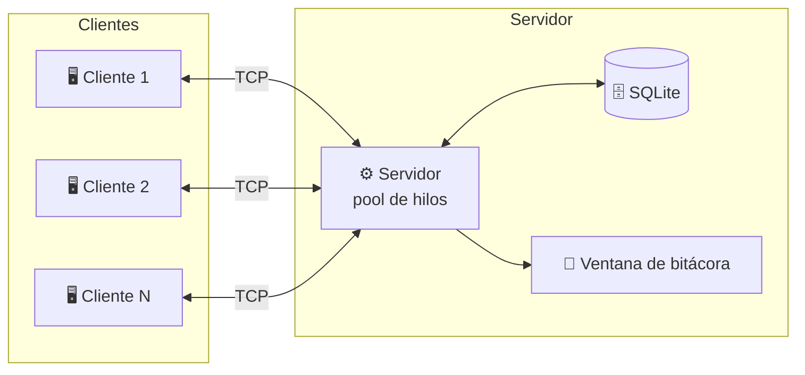

# 💬 Chat Cliente-Servidor

**Sistema de mensajería instantánea con arquitectura cliente-servidor, interfaz gráfica y base de datos centralizada.**

[Progreso](#-progreso) · [Evaluación](#-evaluación) · [Arquitectura](#️-arquitectura) · [Funcionalidad](#-funcionalidad) · [Tareas](#-tareas-por-integrante) · [Cómo contribuir](#-cómo-contribuir)

---

> [!IMPORTANT]
> **Mínimo para que califiquen el programa:** enviar un mensaje entre dos usuarios en **dos computadoras distintas**.
>
> - El equipo tiene que estar **completo** el día de la entrega.
> - Hay **una sola oportunidad** de entrega.
> - Mientras califican a un equipo, el otro no está presente.

## 📊 Progreso

> Las barras se calculan solas a partir de las casillas de [Tareas](#-tareas-por-integrante). No las edites a mano.

<!-- PROGRESO:INICIO -->

| | Avance |
|---|---|
| 🏁 **Total** | `░░░░░░░░░░░░░░░░░░░░` 0% &nbsp; (0/106 tareas) |
| 💻 Código | `░░░░░░░░░░░░░░░░░░░░` 0% |
| 📄 Documentación | `░░░░░░░░░░░░░░░░░░░░` 0% |

| Área | Responsable | 💻 Código | 📄 Docs | Total |
|---|---|---|---|---|
| 🎯 Hitos | Todo el equipo | `░░░░░░░░░░` 0% | `░░░░░░░░░░` 0% | `░░░░░░░░░░` 0% |
| 00 · Documentación general | Integrante 1 | — | `░░░░░░░░░░` 0% | `░░░░░░░░░░` 0% |
| 01 · Arquitectura e integración | _sin asignar_ | `░░░░░░░░░░` 0% | `░░░░░░░░░░` 0% | `░░░░░░░░░░` 0% |
| 02 · Base de datos | _sin asignar_ | `░░░░░░░░░░` 0% | `░░░░░░░░░░` 0% | `░░░░░░░░░░` 0% |
| 03 · Núcleo del servidor | _sin asignar_ | `░░░░░░░░░░` 0% | `░░░░░░░░░░` 0% | `░░░░░░░░░░` 0% |
| 04 · Ventana del servidor | _sin asignar_ | `░░░░░░░░░░` 0% | `░░░░░░░░░░` 0% | `░░░░░░░░░░` 0% |
| 05 · Registro | _sin asignar_ | `░░░░░░░░░░` 0% | `░░░░░░░░░░` 0% | `░░░░░░░░░░` 0% |
| 06 · Inicio de sesión | _sin asignar_ | `░░░░░░░░░░` 0% | `░░░░░░░░░░` 0% | `░░░░░░░░░░` 0% |
| 07 · Recuperar acceso y eliminar cuenta | _sin asignar_ | `░░░░░░░░░░` 0% | `░░░░░░░░░░` 0% | `░░░░░░░░░░` 0% |
| 08 · Ventana 1: Usuarios | _sin asignar_ | `░░░░░░░░░░` 0% | `░░░░░░░░░░` 0% | `░░░░░░░░░░` 0% |
| 09 · Amistades y notificaciones | _sin asignar_ | `░░░░░░░░░░` 0% | `░░░░░░░░░░` 0% | `░░░░░░░░░░` 0% |
| 10 · Ventana 2: Chat de amigos | _sin asignar_ | `░░░░░░░░░░` 0% | `░░░░░░░░░░` 0% | `░░░░░░░░░░` 0% |
| 11 · Ventana 3: Grupos | _sin asignar_ | `░░░░░░░░░░` 0% | `░░░░░░░░░░` 0% | `░░░░░░░░░░` 0% |
<!-- PROGRESO:FIN -->

## 🧮 Evaluación

| Rubro | Qué se entrega | Calificación |
|---|---|---|
| 📘 Documentación técnica | PDF, Parte 1: punto de vista del desarrollador | Igual para todo el equipo |
| 📗 Manual de usuario | PDF, Parte 2: punto de vista del cliente | Igual para todo el equipo |
| ⚙️ Funcionalidad del programa | Demo en vivo (la rúbrica se publica después) | Igual para todo el equipo |
| 🤝 Coevaluación | Evaluación entre integrantes | **Individual** |

<b>📘 Contenido del PDF</b>

**Parte 1: Punto de vista del desarrollador**
- Portada e índice
- Problemática (desarrollada, no 3 renglones)
- Casos de uso: uno por integrante
- Diagramas de secuencia: uno por integrante, cada uno sobre una acción
- Diagrama de clases con todas sus relaciones
- Diagrama de la base de datos
- Conclusión de cada integrante

**Parte 2: Punto de vista del cliente**
- Portada e índice
- Descripción del sistema como producto
- Requisitos mínimos
- Proceso de instalación (se entregan los `.jar`, no el proyecto de NetBeans)
- ¿Cómo se usa? (muy descriptivo, con capturas)

## 🏗️ Arquitectura

Ningún mensaje viaja directo de un cliente a otro: **todo pasa por el servidor**, que lo guarda, lo registra en la bitácora y lo reenvía.

## 🧩 Funcionalidad

| Módulo | Reglas clave |
|---|---|
| 🔐 **Acceso** | Registro con credenciales. Si el usuario falla 3 veces, se bloquea o se envía al registro. Puede recuperar su acceso en cualquier momento con información que dio antes (pregunta de seguridad). |
| 👥 **Ventana 1: Usuarios** | Todos los registrados, divididos en conectados y desconectados en tiempo real. Solo se puede chatear con conectados. El historial **se pierde** cuando el otro cierra sesión. Cerrar la ventana no es cerrar la sesión. |
| 🫂 **Ventana 2: Amigos** | La solicitud se envía desde la ventana 1. Se puede mandar mensaje aunque el amigo esté desconectado y le llega al conectarse. El historial **siempre se conserva** y es distinto del de la ventana 1. Al eliminar al amigo se borra la conversación. |
| 👨‍👩‍👧 **Ventana 3: Grupos** | Mínimo 3 integrantes contando al dueño; las invitaciones pendientes cuentan. La invitación llega por el chat de amigos. El dueño puede agregar, quitar, renombrar o eliminar. Si quedan menos de 3, el grupo se elimina junto con su historial. Quien se une ve todo el historial. |
| 🔔 **Notificaciones** | Solicitudes, invitaciones y mensajes nuevos. |
| 📜 **Servidor** | Ventana con el historial de todo lo que pasa. El servidor ve todo. |
| 🗑️ **Eliminar cuenta** | Borra en cascada amistades, mensajes y grupos. |

## ✅ Tareas por integrante

> Pon tu nombre después del `—` en tu encabezado y marca `[x]` cuando termines una tarea.
> Las tareas `💻` son de código y las `📄` de documentación. Detalle en [`TAREAS.md`](TAREAS.md).

<!-- TAREAS:INICIO -->

### 🎯 Hitos — Todo el equipo
- [ ] 💻 Mensaje entre dos usuarios en **dos computadoras** (mínimo para calificar)
- [ ] 💻 Prueba de todas las funciones en la red del salón
- [ ] 💻 Ensayo de la entrega con el equipo completo
- [ ] 📄 PDF de documentación técnica terminado
- [ ] 📄 PDF de manual de usuario terminado

### 00 · Documentación general — Integrante 1
- [ ] 📄 Portada (Parte 1 y Parte 2)
- [ ] 📄 Índice (Parte 1 y Parte 2)
- [ ] 📄 Problemática desarrollada
- [ ] 📄 Diagrama de clases integrado
- [ ] 📄 Descripción del sistema como producto
- [ ] 📄 Requisitos mínimos
- [ ] 📄 Proceso de instalación
- [ ] 📄 Armado final del PDF

### 01 · Arquitectura e integración —
- [ ] 💻 Estructura del proyecto (`comun`, `servidor`, `cliente`)
- [ ] 💻 Protocolo: clase `Paquete` y tipos de mensaje
- [ ] 💻 Conexión del cliente (enviar y recibir en un hilo)
- [ ] 💻 Configurar IP y puerto del servidor desde la GUI
- [ ] 💻 Generar `Servidor.jar` y `Cliente.jar`
- [ ] 💻 Integrar las ramas de todos
- [ ] 📄 Caso de uso: Conectar cliente al servidor
- [ ] 📄 Diagrama de secuencia
- [ ] 📄 Conclusión

### 02 · Base de datos —
- [ ] 💻 Esquema SQLite (usuarios, amistades, mensajes, grupos, miembros, bitácora)
- [ ] 💻 DAOs para que nadie escriba SQL suelto
- [ ] 💻 Borrado en cascada (`ON DELETE CASCADE`)
- [ ] 💻 Datos de prueba
- [ ] 📄 Diagrama de la base de datos
- [ ] 📄 Caso de uso: Eliminar cuenta
- [ ] 📄 Diagrama de secuencia
- [ ] 📄 Conclusión

### 03 · Núcleo del servidor —
- [ ] 💻 `ServerSocket` con pool de hilos (para que no se sature)
- [ ] 💻 Registro de clientes conectados
- [ ] 💻 Enrutamiento de mensajes C1 → servidor → C3
- [ ] 💻 Aviso a todos cuando alguien se conecta o desconecta
- [ ] 💻 Manejo de desconexiones abruptas
- [ ] 📄 Caso de uso: Enrutar mensaje
- [ ] 📄 Diagrama de secuencia
- [ ] 📄 Conclusión

### 04 · Ventana del servidor —
- [ ] 💻 Bitácora en tiempo real
- [ ] 💻 Búsqueda y filtro en el historial
- [ ] 💻 Vista de usuarios, amistades, grupos y mensajes
- [ ] 💻 Bitácora guardada en la BD
- [ ] 📄 Caso de uso: Consultar bitácora
- [ ] 📄 Diagrama de secuencia
- [ ] 📄 Manual: ¿Cómo se usa el servidor?
- [ ] 📄 Conclusión

### 05 · Registro —
- [ ] 💻 Formulario de registro
- [ ] 💻 Validaciones (usuario único, contraseña)
- [ ] 💻 Pregunta y respuesta de seguridad
- [ ] 💻 Contraseña guardada con hash
- [ ] 📄 Caso de uso: Registrar usuario
- [ ] 📄 Diagrama de secuencia
- [ ] 📄 Manual: Registro
- [ ] 📄 Conclusión

### 06 · Inicio de sesión —
- [ ] 💻 Ventana de inicio de sesión
- [ ] 💻 Validación contra el servidor
- [ ] 💻 Bloqueo al tercer intento fallido
- [ ] 💻 Mandar al registro si el usuario no existe
- [ ] 💻 Impedir dos sesiones abiertas con el mismo usuario
- [ ] 📄 Caso de uso: Iniciar sesión
- [ ] 📄 Diagrama de secuencia
- [ ] 📄 Manual: Inicio de sesión
- [ ] 📄 Conclusión

### 07 · Recuperar acceso y eliminar cuenta —
- [ ] 💻 Ventana de recuperación con pregunta de seguridad
- [ ] 💻 Restablecer contraseña y desbloquear
- [ ] 💻 Botón "Eliminar mi cuenta" con confirmación
- [ ] 📄 Caso de uso: Recuperar acceso
- [ ] 📄 Diagrama de secuencia
- [ ] 📄 Manual: Recuperar acceso y eliminar cuenta
- [ ] 📄 Conclusión

### 08 · Ventana 1: Usuarios —
- [ ] 💻 Lista de conectados y desconectados en tiempo real
- [ ] 💻 Chat temporal, solo con conectados
- [ ] 💻 Borrar el historial cuando el otro cierra sesión
- [ ] 💻 Cerrar ventana ≠ cerrar sesión
- [ ] 💻 Botón "Agregar amigo" (se conecta con 09)
- [ ] 📄 Caso de uso: Enviar mensaje a un conectado
- [ ] 📄 Diagrama de secuencia
- [ ] 📄 Manual: Ventana de usuarios
- [ ] 📄 Conclusión

### 09 · Amistades y notificaciones —
- [ ] 💻 Enviar solicitud de amistad
- [ ] 💻 Aceptar o rechazar solicitud
- [ ] 💻 Eliminar amigo
- [ ] 💻 Ventana de notificaciones
- [ ] 📄 Caso de uso: Enviar y aceptar solicitud
- [ ] 📄 Diagrama de secuencia
- [ ] 📄 Manual: Amigos y notificaciones
- [ ] 📄 Conclusión

### 10 · Ventana 2: Chat de amigos —
- [ ] 💻 Lista de amigos con su estado
- [ ] 💻 Chat persistente, separado del de la ventana 1
- [ ] 💻 Mensajes a desconectados entregados al conectarse
- [ ] 💻 Borrar la conversación al eliminar al amigo
- [ ] 💻 Invitación a grupo dentro del chat (se conecta con 11)
- [ ] 📄 Caso de uso: Enviar mensaje a un amigo desconectado
- [ ] 📄 Diagrama de secuencia
- [ ] 📄 Manual: Chat de amigos
- [ ] 📄 Conclusión

### 11 · Ventana 3: Grupos —
- [ ] 💻 Crear grupo invitando al menos a 2 amigos
- [ ] 💻 Aceptar o rechazar invitación
- [ ] 💻 Chat de grupo persistente; quien se une ve todo el historial
- [ ] 💻 Dueño: agregar, quitar, renombrar, eliminar
- [ ] 💻 Salir del grupo
- [ ] 💻 Eliminar el grupo si quedan menos de 3
- [ ] 📄 Caso de uso: Crear grupo e invitar amigos
- [ ] 📄 Diagrama de secuencia
- [ ] 📄 Manual: Grupos
- [ ] 📄 Conclusión

<!-- TAREAS:FIN -->

## 🤝 Cómo contribuir

1. Crea tu rama: `git checkout -b feature/<tu-parte>`
2. Usa el **protocolo** del integrante 1 y los **DAOs** del integrante 2. No inventes mensajes de red ni escribas SQL suelto.
3. Abre un Pull Request a `main`.
4. Cuando termines una tarea, marca `[x]` en este README. Al subirlo a `main`, GitHub Actions recalcula las barras.
   - Si quieres verlo antes, corre `python3 scripts/progreso.py`.
5. Tu parte del documento va en el Google Doc del equipo (pide el enlace en el grupo).
